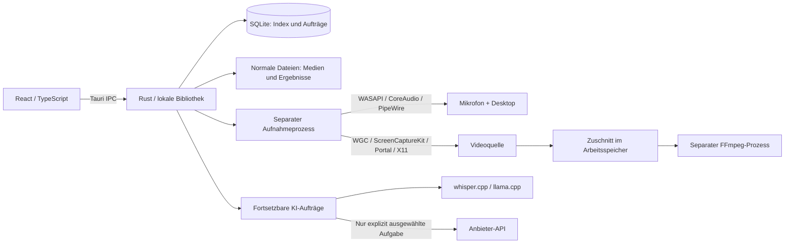

# Architektur

Die Bibliothek besitzt eine prozessübergreifende Dateisperre. Eine zweite App-Instanz kann dieselbe Bibliothek nicht gleichzeitig öffnen und laufende Aufträge irrtümlich als Wiederherstellungsfälle übernehmen. Medienlöschung entfernt auch importierte Originalformate; Transkript, Notizen und Auswertung bleiben bei dieser Option erhalten.



## Prozesse und Verantwortung

`src-tauri/src/capture.rs` startet als `--capture-worker` im selben Programm, aber eigenem Prozess. Steuerung über stdin, Ereignisse als JSON über stdout. Die Aufnahme hängt weder an Modellantworten noch an Browser-Rendering. Mikrofon und Loopback liefern 48-kHz-Mono-Spuren auf einer gemeinsamen aktiven Zeitleiste; Pause entfernt Zeit aus dieser Zeitleiste. Fehlende Samples bleiben als Lücken erhalten. Der Mix verändert die Originalspuren nicht.

Windows nutzt flexaudio/WASAPI und scap/Windows Graphics Capture. macOS nutzt CoreAudio für das Mikrofon und ScreenCaptureKit für Systemton und Bild; der Audio-Pfad verwirft die kleinen Video-Callback-Buffer. Linux nutzt flexaudio/PipeWire, einen eigenen Portal-/PipeWire-Adapter mit dem freigegebenen Remote-Dateideskriptor und xcap für X11-Aufnahmen. Der vendorte scap-Stand enthält dokumentierte Kompatibilitätskorrekturen.

Video wird vor dem Encoder und jeder KI-Verarbeitung zugeschnitten. Ungültige Regionen werden abgelehnt. Die Auflösung wird auf maximal 1920 Pixel Breite, zehn Bilder pro Sekunde begrenzt. Ein Ausfall der Videoquelle erzeugt eine Warnung und schwarze Bilder; Audio bleibt aktiv. Ein Ausfall des Encoders wird separat gemeldet.

Audio wird in ungefähr fünfsekündigen Segmenten gespeichert. Erst vollständig geschriebene WAV-Dateien gelangen in `capture.json`. Bei Wiederaufnahme der App werden abgeschlossene Segmente in die Bibliothek übernommen. Das letzte Video-Segment wird während laufender Aufnahme nicht als abgeschlossen geführt. Zuverlässigkeit und Synchronität sind auf echter Hardware nachzuweisen.

## Ablage

```text
App-Datenverzeichnis/
  settings.json
  library.sqlite (+ WAL während des Betriebs)
  models/<catalog-id>/...
  meetings/<uuid>/
    meeting.json
    capture.json
    worker.json
    microphone-000000.wav
    desktop-000000.wav
    mixed-000000.wav
    video-000000.webm
    playback.wav / playback.webm
    frame-....jpg
    results/analysis-<uuid>.json
```

SQLite ist der Suchindex und die Auftragswarteschlange; Meeting-Dateien sind die dauerhafte Quelle der Bibliotheksdaten. JSON wird über temporäre Dateien mit Wiederherstellungskopie ersetzt. Der Index lässt sich aus den Meetings rekonstruieren. Pfade aus der Oberfläche müssen innerhalb des jeweiligen Meeting-Verzeichnisses bleiben. Dateien und Modelle gehören nicht ins Git-Repository.

## KI-Aufträge und Belege

Interne Grenzen: `CaptureBackend`, `TranscriptionProvider`, `AnalysisProvider`, `VisionProvider`. Transkriptsegmente besitzen stabile IDs und vorläufigen/endgültigen Status. Manuell bearbeitete Segmente werden bei erneuter Verarbeitung erhalten. Quellenverweise werden gegen vorhandene Transkript-/Bild-IDs validiert; ungenannte Verantwortliche und Termine bleiben leer.

Aufträge verwenden deterministische IDs. Neustart setzt unterbrochene Aufträge wieder auf wartend, Wiederholung erzeugt keine zusätzlichen Transkriptkopien. Die finale Auswertung wartet auf die Transkription. Lange Texte werden in Abschnitten ausgewertet; visuelle Auswertung verarbeitet Szenen-/Folienbilder oder explizit gewählte Gemini-Videoclips. Fehler pausieren betroffene Auswertungen. Die Aufnahme läuft weiter.

llama.cpp wird bei Bedarf als authentifizierter Loopback-Server gestartet. Er lauscht ausschließlich auf `127.0.0.1`; sein zufälliges Prozess-Token ist kein Cloud-Schlüssel. whisper.cpp läuft als begrenzter Unterprozess. Cloud-Anfragen durchlaufen eine Prüfung des lokalen Profils und eine atomare Budgetreservierung. Eine API-Anfrage kann unterschiedliche Kosten haben: Das Budget ist eine Aufrufgrenze, keine Euro-Obergrenze.

Live-Transkription nutzt abgeschlossene Abschnitte. Live-Assistenz ergänzt ungefähr minütlich die bisherigen Notizen. Die Finalisierung transkribiert größere Abschnitte mit mehr Kontext erneut, optional mit einem separat gewählten Modell. Erfolgreiche Abschnitte werden zur Wiederaufnahme zwischengespeichert. Bereiche mit manuellen Korrekturen bleiben erhalten; danach entsteht die Gesamtauswertung.
